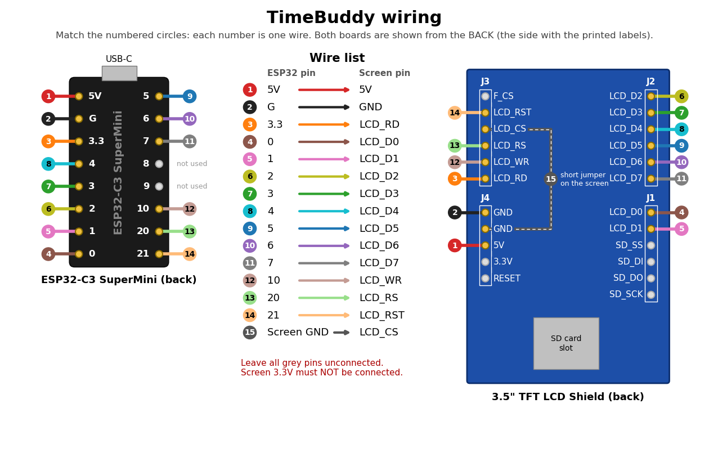

# TimeBuddy

A small desk display showing the time and weather in three locations, plus the next MotoGP and F1 races. Everything is set up from a web page served by the display itself.

## Setup page

Open `http://timebuddy.local` in a browser on the same network. If that doesn't load, use the address shown on the screen while it says "Syncing time…" (also printed on the serial monitor).

TimeBuddy only serves plain HTTP. If you give it a name under a domain that browsers force onto HTTPS (every `.dev` domain, for example), put a reverse proxy such as Traefik or nginx in front of it to handle HTTPS.

The page shows a live copy of the screen. Click the gear to change:

- **Clocks**: the top, middle and bottom locations. Search for a place, pick it from the list, and edit the label if needed.
- **Right side**: which pane goes in the top right and bottom right.
- **Network**: Wi-Fi name and password, and either an automatic (DHCP) or static IP address. Leave the password empty to keep the current one. Saving restarts TimeBuddy.
- **Firmware**: upload a new `firmware.bin`. See [Updating over Wi-Fi](#updating-over-wi-fi).

The preview updates as you change things. Press Save display to apply the clocks and panes. Settings are stored on the device and kept after power-off.

### If TimeBuddy can't join the Wi-Fi

If it can't connect within 30 seconds of starting, TimeBuddy starts its own open Wi-Fi network called `TimeBuddy-Setup` and shows it on the screen. Join it from a phone or laptop and open `http://192.168.4.1` (most phones open it automatically). Fix the network settings and press Save and restart.

If no one uses the setup page for 5 minutes, TimeBuddy restarts and tries the saved Wi-Fi again, so it recovers by itself when the router was just slow to come back after a power cut.

## Default locations

The locations used until you change them on the setup page are set in `firmware/include/locations.h` (not stored in the repository). Copy `locations.example.h` to `locations.h` and set, for each location:

- the label shown on screen
- latitude and longitude, used for the weather
- a POSIX TZ string, used for the time (for example `GMT0BST,M3.5.0/1,M10.5.0` for London)

## Screen layout

Each clock row shows the location label, the local time and date, and the current weather (icon and temperature in °C).

In landscape the clocks take the left 40% of the screen. The right side has two panes, chosen on the setup page:

| Pane | Shows |
|---|---|
| MotoGP | Next MotoGP Grand Prix race |
| F1 | Next Formula 1 race |

Each pane shows:

- the circuit outline (top right)
- the expected weather at the circuit at race start, once the race is within about 15 days
- the circuit location
- the race weekend dates (first practice to race day) and the race start time

Dates and times are shown in the time zone of the location set by `RACE_TIME_LOCATION` in `firmware/include/config.h` (0 = top, 1 = middle, 2 = bottom). Race data is refreshed every 6 hours. Sources: the MotoGP calendar API, the [Jolpica F1 API](https://github.com/jolpica/jolpica-f1) and [Open-Meteo](https://open-meteo.com/) for the forecast.

Portrait shows the clocks only.

## Hardware

| Qty | Part | Notes |
|---|---|---|
| 1 | ESP32-C3 SuperMini (HW-466AB) | Wi-Fi microcontroller with USB-C |
| 1 | 3.5" TFT LCD Shield, Arduino UNO format | 480x320, 8-bit parallel, ILI9486 or ST7796 controller, PCB 85.49 x 55.63 mm |
| 15 | Female-to-female jumper wires | Or solder wires directly |
| 1 | Short wire for the `LCD_CS` to `GND` jumper on the screen | See wiring |
| 1 | USB-C cable | Data-capable for flashing |
| 1 | USB power supply | Any phone charger |
| 1 | 3D-printed case: frame, back and stand | PLA, see Print the case |
| — | Double-sided tape and a little hot glue | Holds the ESP32 and the screen in the frame |

## Photos


## Build Steps

### 1. Print the case

Print the files from `case/`:

| File | Print orientation | Supports |
|---|---|---|
| `timebuddy_frame.stl` | Front face down on the bed | None |
| `timebuddy_back.stl` | Flat side down | None |
| `timebuddy_stand.stl` | Flat side down | None |

PLA, 0.2 mm layers, 20% infill is fine.

The window is 75 x 50.5 mm with an equal border on all four sides. The board pocket behind it is shifted 3 mm to match the panel (the glass sits near one end of the board, with a black strip and ribbon cable at the other). Adjust `WINDOW_OFFSET_X` in `case/make_case.py` and regenerate if needed.

### 2. Wire the screen to the ESP32



The pin labels are printed on the back of the screen.

| Screen pin | Connect to |
|---|---|
| LCD_D0 | ESP32 `0` |
| LCD_D1 | ESP32 `1` |
| LCD_D2 | ESP32 `2` |
| LCD_D3 | ESP32 `3` |
| LCD_D4 | ESP32 `4` |
| LCD_D5 | ESP32 `5` |
| LCD_D6 | ESP32 `6` |
| LCD_D7 | ESP32 `7` |
| LCD_WR | ESP32 `10` |
| LCD_RS | ESP32 `20` |
| LCD_RST | ESP32 `21` |
| LCD_RD | ESP32 `3.3` |
| LCD_CS | Screen `GND` (second GND pin on the screen) |
| 5V | ESP32 `5V` |
| GND | ESP32 `G` |

**Don't skip the `LCD_CS` jumper.** It is a short wire on the screen itself, from `LCD_CS` to the second `GND` pin. Without it the screen may work for a while and then stay white.

Leave unconnected: screen `3.3V`, `RESET`, `F_CS` and all `SD_*` pins; ESP32 pins `8` and `9`.

These pins match `firmware/include/config.h`.

### 3. Assemble

1. Push the screen face-first into the frame the way round that lines the screen up with the window (turned the wrong way, it sits 6 mm off). If it is loose, add a small dab of hot glue in each corner.
2. Tape the ESP32 to the back of the screen with the USB-C port facing down. Keep the `BOOT` button uncovered so you can still press it.
3. Slide the USB cable into the slot in the side wall, then press the back on until it clicks.
4. Slot the bottom edge of the frame into the stand.

### 4. Flash and power

1. Install [PlatformIO](https://platformio.org/install) (VS Code extension or `pip install platformio`).
2. Copy `firmware/include/secrets.example.h` to `firmware/include/secrets.h` and put in your WiFi name and password (used until changed on the setup page).
   Copy `firmware/include/locations.example.h` to `firmware/include/locations.h` and set your three default locations.
3. Plug the ESP32 into your computer with USB-C and run:
   ```
   cd firmware
   pio run -t upload
   ```
   If the upload doesn't start, hold the ESP32's `BOOT` button while plugging it in, then try again.
4. Unplug it and power it from any USB charger.

The screen shows "Connecting…", then "Syncing time…" with the setup page address, then the three clocks. Temperatures update every 10 minutes.

### Updating over Wi-Fi

Once TimeBuddy has been flashed over USB with this firmware, later updates can go over Wi-Fi. Settings are kept.

- From PlatformIO: `pio run -e ota -t upload`. If `timebuddy.local` doesn't resolve, add `--upload-port <address>`.
- From the setup page: build with `pio run -e timebuddy`, then upload `firmware/.pio/build/timebuddy/firmware.bin` in the Firmware section.

The screen shows "Updating firmware" while it writes, then restarts. A file that isn't TimeBuddy firmware is rejected and the running firmware is left as it was.

If you're coming from a version without the Firmware section, flash once over USB first: the flash layout changed to make room for updates.

### 5. Switch between portrait and landscape

Press the `BOOT` button on the ESP32. The screen turns between portrait and landscape straight away, and the choice is remembered after power-off.

### 6. If the screen looks wrong

All settings are in `firmware/include/config.h`. Change one, then upload again.

| Problem | Setting |
|---|---|
| Screen stays white or shows noise | `DISPLAY_ST7796` — change `0` to `1` |
| Picture is upside down | `PORTRAIT_ROTATION` — change `4` to `6`; `LANDSCAPE_ROTATION` — change `1` to `3` |
| Black background shows white | `DISPLAY_INVERT` — change `false` to `true` |

## Regenerating the track outlines

The circuit outlines are stored in `firmware/include/tracks.h`. To pick up new circuits, run:

```
pip install pillow
python tools/make_tracks.py
```

MotoGP outlines come from the MotoGP calendar, F1 outlines from [bacinger/f1-circuits](https://github.com/bacinger/f1-circuits) (MIT licence). The screen shows the outline of the circuit nearest to the race location.

## Regenerating the case

`case/make_case.py` builds both STL files. Requires `trimesh`, `manifold3d` and `numpy`:

```
pip install trimesh manifold3d numpy
python case/make_case.py
```

## Setup page files

The setup page is `firmware/web/index.html`. `firmware/web/zones.json` maps time zone names to POSIX TZ strings and comes from [posix_tz_db](https://github.com/nayarsystems/posix_tz_db) (MIT licence); download a fresh copy if a country changes its daylight saving rules. Both are gzipped into `firmware/include/web.h` by `firmware/make_web.py` on every build.
